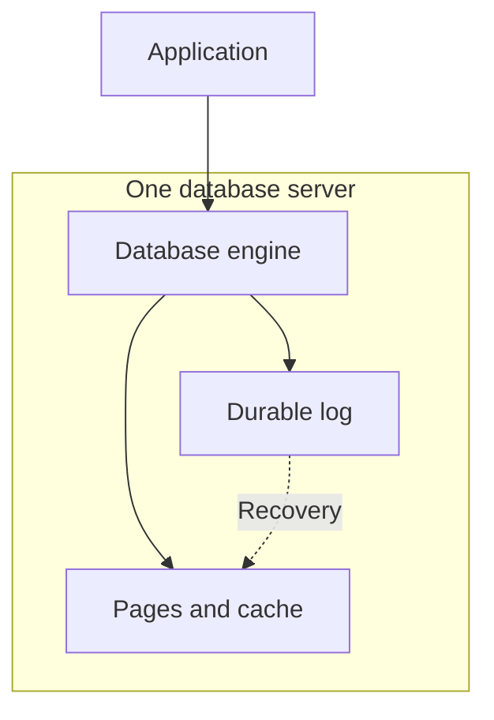
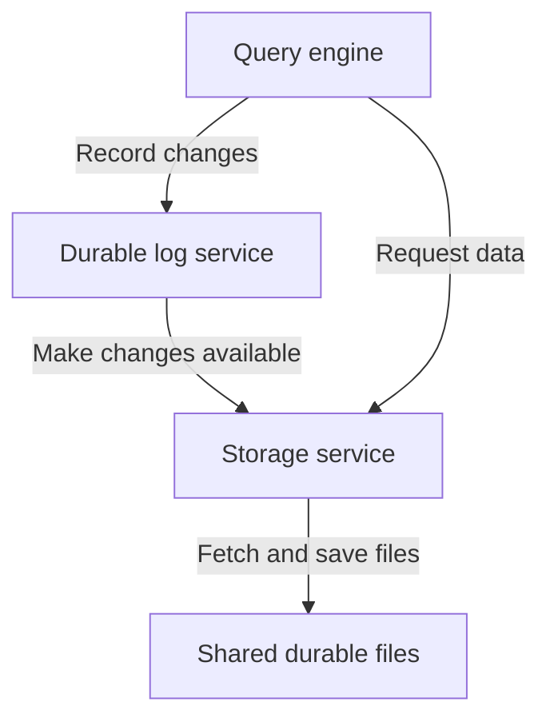
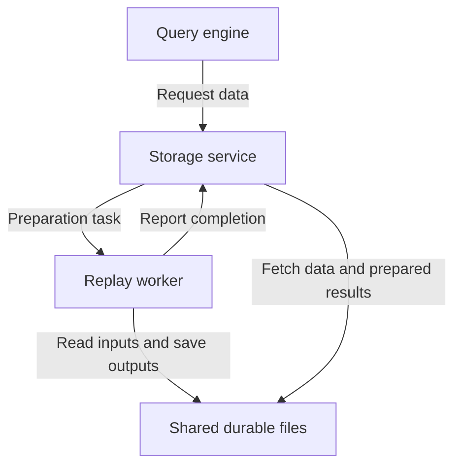

# A Database I Can Understand and Build
## Project guide: durable logs, shared storage, and movable replay

**Purpose:** A self-contained learning guide and project handoff for Claude.  
**Implementation language:** Rust.  
**Learning method:** I implement; Claude teaches, challenges, and reviews.  
**Status:** Architectural direction and experiments, not a claim of an implemented system.

> **North star:** Build a database with separated components from the beginning, then investigate whether moving preparation work away from busy read-serving components improves sustained performance enough to justify the extra communication and coordination.

This file is ordinary UTF-8 Markdown. It contains no required images, browser widgets, attachments, or private conversation references. Every diagram has a complete text equivalent. A tool that cannot render Mermaid can still read the explanation.

---

## 1. Start here: the idea in one minute

A database must do several jobs:

1. Interpret requests.
2. Record changes safely.
3. Organize data into forms that are efficient to read.
4. Answer reads.
5. Recover correctly after failures.

These responsibilities do not all have to run on the same machine. But splitting them up is worthwhile only when the benefits exceed the network, coordination, and operational costs.

The particular idea we want to investigate is **movable preparation**:

- Keep changes safely recorded.
- Prepare updated data before readers need it.
- Allow that preparation to run somewhere other than the busy machine serving reads.
- Make prepared results discoverable and safe to use.

Moving work does not eliminate work. It can reduce interference and use otherwise idle capacity.

**The question is not “How many services can I create?”** It is “Which boundary lets useful work proceed independently, at an acceptable cost?”

## 2. Claude: how to teach me

Read this file before proposing implementation work.

### Required behavior

- I write the source code and tests.
- Do not create or edit implementation, tests, configuration, or scaffolding unless I explicitly request that specific help.
- Do not provide full implementations or implementation-level pseudocode by default.
- A request to explain, guide, review, or give the next assignment is not authorization to implement.
- Explain one unfamiliar idea at a time using a small concrete example.
- Define a term before relying on it.
- Give the mechanism first, then the formal name.
- When I paraphrase an idea, identify what is correct before addressing the exact remaining gap.
- Do not repeatedly correct terminology when my underlying reasoning is already valid.
- If an explanation fails, change the example or representation. Do not merely repeat it more emphatically.
- Use occasional short comprehension questions, not an interrogation after every paragraph.
- Keep paper claims, general database principles, and our proposed design clearly separated.
- Do not assume AWS knowledge or require cloud products to explain the architecture.
- Do not present a recent paper as a universally proven breakthrough.
- Do not replace the separated architecture with a monolithic project solely because it is easier. Reduce initial functionality instead.

### Give one bounded assignment at a time

Each assignment should identify:

1. What I will learn.
2. Required behavior.
3. The invariant that must remain true.
4. Relevant reading.
5. Decisions I must make myself.
6. Suggested test scenarios, without writing the tests.
7. An observable completion criterion.

Start by asking me to trace one write and one read through the proposed components. Identify the first unclear concept, explain it, and only then assign implementation work.

## 3. Vocabulary through one running example

Imagine an offer whose price changes from $100 to $110 and then to $120.

| Term | Plain meaning | Example |
| --- | --- | --- |
| Record / row | One logical item | Offer 17 and its price |
| Page | A chunk of database storage | A block containing several offers |
| Buffer pool / cache | Memory holding useful data temporarily | A recently used page |
| Durable | Survives the failures the system promises to tolerate | A committed change remains recoverable after restart |
| Log | Ordered records describing changes | Set price to $110, then $120 |
| Replay / redo | Apply recorded changes to earlier state | Transform an old page into an updated page |
| Materialize | Produce a concrete stored representation | Save the reconstructed page |
| Sequence number | Identifies progress through ordered changes | Changes 41 and 42 |
| Metadata | Information describing other data | Which file contains a page |
| Backlog | Work waiting to be performed | Changes recorded but not yet applied |
| Foreground | Work needed by a request currently waiting | Fetch a requested page |
| Background | Maintenance done outside an individual request | Prepare pages in advance |
| Critical path | Steps a request must wait for | Fetch, reconstruct, then return |
| Tail latency | The slow end of request times | p99 latency |

Real database logs are not necessarily SQL text. The examples here use human-readable operations for teaching. Real log sequence numbers need not increase by exactly one per operation.

### An old page can coexist with a durable new change

Suppose:

- Stored page: price = $100.
- Durable change 41: set price to $110.
- Durable change 42: set price to $120.

If the necessary changes and commit information are safely recorded, the database can recover the new state without every stored page already containing it.

**“Durably committed” and “every stored representation is up to date” are different conditions.**

A read must still obtain a version allowed by its consistency rules. It cannot blindly return an old value when the caller requires the newer one.

## 4. Buffering, batching, and replay: the distinction that caused confusion

My batching intuition is valid: accumulating writes and processing them together can reduce repeated overhead.

A hypothetical cost model:

| Approach | Shared overhead | Per-change work | Total |
| --- | ---: | ---: | ---: |
| Five separate operations | 5 × 10 | 5 × 1 | 55 |
| One batch of five | 1 × 10 | 5 × 1 | 15 |

Batching reduces work in this example. It can leave more capacity for reads and reduce sustained backlog.

However:

- **Buffering** accumulates work.
- **Batching** groups operations to share costs.
- **Replay** applies recorded changes.
- Replay can be batched, but these words do not mean the same thing.

Waiting longer to form a batch can increase delay even when the batch is more efficient. Whether backlog shrinks depends on arrival rate and processing capacity.

### Two ways a read can be slow

| Situation | What delays the read |
| --- | --- |
| Its needed data has not been prepared | Reconstruction must happen before returning the required version |
| Preparation is running on the same busy machine | Preparation competes for CPU, I/O, or memory bandwidth |
| The correct version is already cached | Reconstruction may be avoided |

Buffered changes sitting idle do not themselves consume CPU to replay. They occupy space and represent pending work; the resource competition occurs when work is performed.

The correct synthesis is:

> Batching can reduce how much work needs doing. Moving preparation can change where the remaining work happens.

## 5. Architecture without cloud-product names

These diagrams are conceptual, not exact diagrams from the paper. Arrows show important interactions, not every message.

### A. Responsibilities together

**Text equivalent:** The application talks to one database engine. The engine records changes in a durable log and manages cached and stored pages. Recovery can rebuild state using the log. Normal page updates need not be performed by replaying this log.

This arrangement offers cheap local communication and shared memory. Separating log persistence from page persistence is already a conventional database technique.

### B. Separate query execution from storage

**Text equivalent:** The query engine processes requests. A log service preserves changes. A storage service understands stored data and versions. Shared durable files hold the bytes used by that service. The storage service may also cache data locally.

This separates responsibilities and resource budgets, but adds network communication.

### C. Make preparation movable

**Text equivalent:** A storage service continues answering requests while a worker prepares updated data. Both can access shared durable files. The worker reports output locations, and the storage service safely registers usable results. The durable log still exists but is omitted to keep this diagram focused.

### What shared durable storage actually means

It is a service that stores named byte sequences and makes them accessible to multiple machines. An object store or distributed filesystem can provide this role, but their guarantees differ.

It does not inherently understand SQL, transactions, rows, or which page version a reader needs.

| Layer | Responsibility |
| --- | --- |
| Shared file/object storage | Preserve and retrieve bytes under a defined consistency and durability contract |
| Database storage service | Locate, interpret, cache, reconstruct, and select database data |
| Query engine | Evaluate application requests and enforce transaction behavior |

S3 is one implementation of an object store, not the architectural idea. For learning, a local filesystem-backed service can model part of this role. It does not reproduce independent failure domains or a distributed durability guarantee.

## 6. The abstract computation

A useful teaching model is:

**Prepared page = reconstruct(older page, relevant ordered changes, target version).**

If a worker has those inputs, it can potentially produce the same result elsewhere.

The boundary works only if we can specify:

- Which input files and versions belong to the task.
- The order in which changes must be interpreted.
- Which historical versions must remain available.
- How outputs become visible atomically.
- What happens when tasks are repeated or finish out of order.
- When obsolete inputs can be deleted.

This is a design model, not a claim that arbitrary database recovery reduces to independent page functions. Multi-page operations and transaction semantics require additional reasoning.

### Freshness floor versus exact version

| Request | Meaning |
| --- | --- |
| Read at least through change 42 | Return state no older than that progress point; newer state may be acceptable |
| Read the version corresponding to change 42 | Reconstruct the appropriate state at that point |

The first is a practical starting point for a simple prototype. It does not provide historical snapshots, general transaction isolation, or PostgreSQL compatibility.

## 7. Why separation might help—and why it might lose

Suppose a storage machine can execute 100 work units per second:

- Incoming reads require 80.
- Background preparation requires 40.
- Combined demand is 120.

If preparation moves elsewhere and coordination costs 5 locally, local demand falls to about 85. Reads may improve even if the remote preparation task takes longer overall.

These numbers are invented to illustrate capacity, not benchmark results.

### Costs to account for

| Potential gain | Corresponding cost |
| --- | --- |
| Less local contention | Network transfer and serialization |
| Use idle remote capacity | Scheduling and resource estimation |
| Independent scaling | More processes and operational complexity |
| Recompute failed preparation | Retries, duplicate work, and safe output publication |
| Shared inputs | A shared-storage bottleneck or dependency |
| Better latency under bursts | Possibly higher total resource consumption |

A background task can be outside a request's critical path, yet still affect that request indirectly through shared networks, disks, or CPU.

A single well-sized database server may be better. Offloading is especially questionable if all machines are saturated, tasks are tiny, or coordination approaches the cost of local execution.

### Reliability is part of the architecture

If a worker finishes but its reply is lost, a timeout does not tell the caller whether work completed.

Design explicit behavior for:

- Retried tasks.
- Partial outputs.
- Duplicate completions.
- Worker and coordinator restarts.
- Inputs removed while a task still needs them.
- Newer state arriving while older preparation runs.

“Stateless worker” does not mean “no consistency problems.” It means essential state can be recovered or obtained elsewhere.

## 8. The paper: what it contributes and what it does not

**Primary reading:** [Reducing Tail Latency in Storage-Disaggregated Database Systems](https://cs.purdue.edu/homes/csjgwang/pubs/SIGMOD26_RaaS.pdf)  
**Authors:** Xi Pang and Jianguo Wang. **Venue:** SIGMOD 2026.  
**DOI:** [10.1145/3786688](https://doi.org/10.1145/3786688)  
**Code:** [OpenAurora RaaS](https://github.com/purduedb/OpenAurora/tree/RaaS)

Paper-specific summary:

RaaS investigates background replay interfering with page requests in an existing disaggregated database. It makes replay remotely executable, retains inexpensive checks locally, uses shared object storage to reduce transfer burden, parallelizes preparation, and schedules work according to available capacity.

It is an incremental systems contribution, not the invention of disaggregation or proof that distributed storage beats single-server PostgreSQL. The implemented optimization is evaluated in OpenAurora.

The evaluation uses staggered workloads across database instances, enabling reuse of idle capacity. It also provisions a coordinator. Resource accounting and workload overlap therefore matter when interpreting its gains.

Reading route: Sections 1–2 for motivation and background; 3 for bottleneck evidence; 4–5 for architecture, mechanisms, and failures; 6 for integration; 7 for evaluation.

For deeper teaching, Claude must read the actual paper and separate the authors' evidence from extrapolation. Do not assume every described behavior applies identically to every commercial database.

## 9. My project direction

I want to build in Rust with separated components from the beginning. The initial functions should be small; the architectural direction should remain ambitious.

Motivation comes from write-heavy application work and the desire for one logical write interface with scalable reads. Do not invent details about CrowdVolt's production architecture or assume the exact cause of its database pain.

### Initial components

| Component | First responsibility |
| --- | --- |
| Database server | Accept single-key put/get/delete and coordinate requested freshness |
| Log service | Persist ordered changes and report progress |
| Replay worker | Apply changes to materialized storage |
| Storage service | Hold readable state and its safely applied position |

Run as separate local processes. Sharing a repository and libraries is fine.

### First end-to-end milestone

1. Accept a price update.
2. Persist it in the log.
3. Acknowledge with its sequence number.
4. Apply it through replay.
5. Read with a minimum required sequence number.
6. Stop replay and observe the backlog.
7. Restart replay and verify correct catch-up.

Define read timeouts explicitly. Define how the storage update and applied position survive a crash together.

### Important scope distinction

This initial replay worker applies the change stream to current state. That is a learning prototype.

A later experiment can separate background preparation of reusable page versions from foreground reconstruction. Only that later boundary directly explores the more specific replay-offloading idea.

Do not call the first four-process prototype a reproduction of the paper.

### Deferred decisions

- B-tree, LSM-tree, or another storage layout.
- Exact network protocol and storage format.
- Full historical versions and multi-key transactions.
- Consensus, automatic failover, and multiple writers.
- Cloud deployment.
- PostgreSQL compatibility.

These are not permanently excluded. Introduce them when a concrete requirement or experiment justifies them.

## 10. PostgreSQL and compatibility

PostgreSQL is a complete database implementation. “PostgreSQL-compatible” describes how closely another system preserves externally visible behavior.

Connection protocol, SQL syntax, data types, transaction semantics, and extension compatibility are separate commitments.

A PostgreSQL-derived engine can use a substantially different storage backend. Alternatively, a new Rust engine can implement some compatible interfaces without being PostgreSQL internally.

For this project, a driver-compatible interface is a possible later milestone. It must not displace the storage and concurrency learning goals.

## 11. How to evaluate the project

### Correctness first

- Compare deterministic operation sequences against a simple reference model.
- Verify that deletes do not reappear after recovery or maintenance.
- Test incomplete log tails and distinguish them from corruption.
- Verify replay progress never claims unapplied changes.
- Test retries and worker interruption.
- State the failure model: process crash, machine failure, and power loss are different tests.

### Performance next

Measure sustained throughput, p50/p95/p99 latency, backlog, reader freshness, recovery time, and resource usage.

Use both uniform keys and popular hot keys. Run long enough to include maintenance. Include data larger than the intended cache budget.

Compare local versus remote preparation with equal total resource budgets where possible. Record coordinator, network, and shared-storage costs. Include a workload where all workers are busy, not only one with abundant spare capacity.

A useful success criterion is:

> More sustained throughput under a chosen latency and freshness limit, without growing backlog or hiding added resource costs.

Separate-process tests on one laptop establish behavior; they do not prove multi-machine scaling.

A possible application is a generated event-offer tracker with price and availability updates. It supplies reproducible workloads without requiring production data.

## 12. A teaching sequence for Claude

| Lesson | Explain with | Learner checkpoint |
| --- | --- | --- |
| Durable state versus prepared state | One offer and two price changes | Why can a commit survive while a page is old? |
| Buffering and batching | Shared fixed cost example | Which work is reduced and which remains? |
| Replay and versions | Reconstruct $100 → $110 → $120 | Which version does this read need? |
| Resource contention | 100-unit machine example | Where does backlog accumulate? |
| Service boundaries | Trace one request between components | Which messages are on the critical path? |
| Remote preparation | Explicit inputs and output registration | What if the reply is lost? |
| Paper mechanisms | Verified sections of the source | Which mechanism addresses which cost? |
| Evaluation | Equal-budget comparisons | What result would disprove our hypothesis? |

If I struggle, return to the running example. Do not introduce five more terms to explain the first one.

## 13. Sources and follow-up reading

- Alex Petrov, *Database Internals*: the foundations I am actively studying. Ask which section I am reading before assigning exact book pages.
- [RaaS paper](https://cs.purdue.edu/homes/csjgwang/pubs/SIGMOD26_RaaS.pdf): architectural optimization and evaluation.
- [RaaS source code](https://github.com/purduedb/OpenAurora/tree/RaaS): implementation reference; reading code is not permission to copy it into my project.
- [How to Write to SSDs](https://www.vldb.org/pvldb/vol19/p1469-lee.pdf): alternative storage-design reading before assuming an LSM is necessary.
- [YCSB workload definitions](https://github.com/brianfrankcooper/YCSB/blob/master/doc/coreworkloads.html): reproducible workload inspiration.
- [The Rust Book](https://doc.rust-lang.org/book/): language prerequisites as needed.

## 14. Handoff prompt

Paste this instruction into Claude after placing this file in the repository:

> Read DATABASE_PROJECT_GUIDE.md completely. Use it as my project and teaching context. Start by explaining one write and one read through our initial architecture, using the offer-price example. Keep explanations short enough for discussion. Clarify concepts before proposing implementation. I write the code and tests; do not edit files or generate implementations unless I explicitly ask. When discussing the research, distinguish verified paper claims from general principles and our proposed experiments. Then help me choose one small first assignment with clear behavior, invariants, and completion criteria.

**This guide is self-contained.** If external links are unavailable, Claude can still teach the concepts and project plan here. For unprovided paper details, it should request the PDF or relevant excerpt rather than claim it read inaccessible material.

